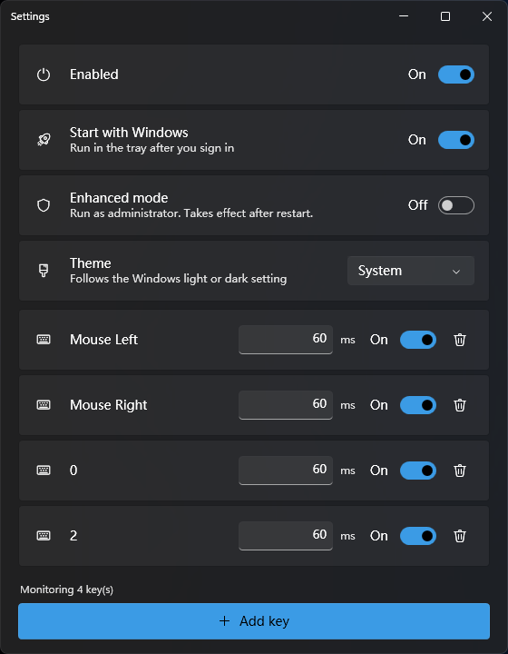

# DoubleClickHealer

[简体中文](README.md) | **English**

Fixes mouse **double-clicks and chatter** caused by worn switches, as well as keyboard chatter and repeated triggers.

A Windows tray utility that runs in the background, supporting both **mouse** and **keyboard** with per-key thresholds.

## Requirements

- Windows 10 / 11 (x64)

## Usage

1. On first launch, mouse left and right buttons (60 ms) are added and start-with-Windows is enabled
2. Click “Add key” and press the key you want to fix
3. Adjust the threshold per key (0–120 ms):
   - Mouse: 60–100 ms recommended
   - Keyboard: **60 ms** by default, same as mouse; lower it to **0 (lightweight mode)** if modifier release feels delayed during fast key combinations
4. Closing or minimizing sends the window to the tray. Left-click the tray icon to open settings, right-click for the menu
5. Change the UI language from settings or the tray menu; restart to apply
6. Enhanced mode starts the app as administrator through a Windows scheduled task to cover elevated windows

## Download and install

Download `DoubleClickHealer_xx.exe` from [Releases](https://github.com/yaohongcool/DoubleClickHealer/releases) and run it from any folder. No installation is needed.

Settings and logs:

- Settings: `%APPDATA%\DoubleClickHealer\config.json`
- Logs: `%LOCALAPPDATA%\DoubleClickHealer\logs\app.log`

## Choosing a threshold

- The threshold is the maximum interval still treated as chatter. Higher values filter more aggressively but also risk swallowing intentional fast clicks or keystrokes.
- Start at 60 ms and increase by 10–20 ms if double-clicks remain; usually no more than 100 ms is needed.

## Enhanced mode

The app runs with normal privileges by default and fixes most applications. Windows that run as administrator (Task Manager, some installers, etc.) require enhanced mode:

- Enabling it requests UAC once and creates a logon scheduled task, so the app starts elevated on future sign-ins
- After upgrading to a new file name, toggle enhanced mode off and on again so the scheduled task points to the new path

## FAQ

**I set a threshold but double-clicks remain.** Make sure the key is in the list and enabled, then raise the threshold step by step; check the log if it still happens.

**It does not work in elevated applications.** Enable enhanced mode and restart the app.

**How do I uninstall completely?** Exit the app, turn off start-with-Windows and enhanced mode, delete the exe, then remove `%APPDATA%\DoubleClickHealer` and `%LOCALAPPDATA%\DoubleClickHealer`.

## License

This project is licensed under the [MIT License](LICENSE).
