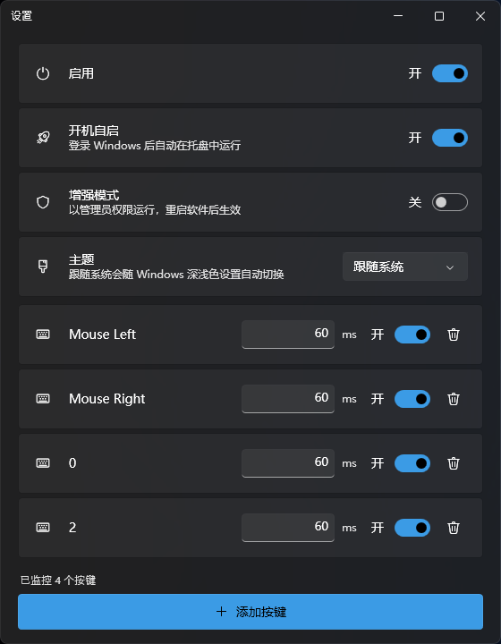

# 双击修复器

**简体中文** | [English](README.en.md)

修复因微动开关或轴体老化产生的鼠标**双击、连击**，以及键盘连击、重复触发。

Windows 托盘小工具，后台常驻，支持**鼠标**和**键盘**，每个按键可单独设置阈值。

## 系统要求

- Windows 10 / 11（x64）

## 使用

1. 首次启动会自动添加鼠标左键、右键（60ms），并默认开启开机自启
2. 点「＋ 添加按键」，按下需要修复的键即可加入列表
3. 每个按键可单独调整阈值（0~120ms）：
   - 鼠标推荐 60~100ms
   - 键盘默认 **60ms**，与鼠标一致；如果快速组合输入时感觉修饰键松手延迟，可调低到 **0（轻量模式）**
4. 关闭窗口或最小化会收进托盘；左键单击托盘图标打开设置，右键打开菜单
5. 界面语言可在设置或托盘菜单切换，重启后生效
6. 增强模式通过 Windows 计划任务以管理员权限启动，用于修复以管理员运行的窗口

## 下载与安装

从 [Releases](https://github.com/yaohongcool/DoubleClickHealer/releases) 下载 `DoubleClickHealer.exe`，放到任意目录双击运行即可，免安装。

配置和日志位置：

- 配置：`%APPDATA%\DoubleClickHealer\config.json`
- 日志：`%LOCALAPPDATA%\DoubleClickHealer\logs\app.log`

## 阈值怎么选

- 阈值是判定为“抖动”的最大间隔。设得越大过滤越强，但正常快速点击/输入被误判的风险也越高。
- 建议从 60ms 开始；仍有双击时，每次提高 10~20ms，一般不超过 100ms。

## 增强模式

默认以普通权限运行，可修复大多数程序。以管理员权限运行的窗口（例如任务管理器、部分安装器）需要开启「增强模式」：

- 开启时请求一次 UAC，并创建登录计划任务，之后每次登录以管理员权限启动

## 常见问题

**阈值调了但仍有双击？** 确认按键在列表中并已启用，然后逐步提高阈值；仍无效时查看日志。

**管理员程序里不生效？** 开启增强模式后重启软件。

**如何完全卸载？** 退出程序，关闭开机自启和增强模式，删除 exe 以及 `%APPDATA%\DoubleClickHealer`、`%LOCALAPPDATA%\DoubleClickHealer`。

## 许可证

本项目采用 [MIT License](LICENSE)。
